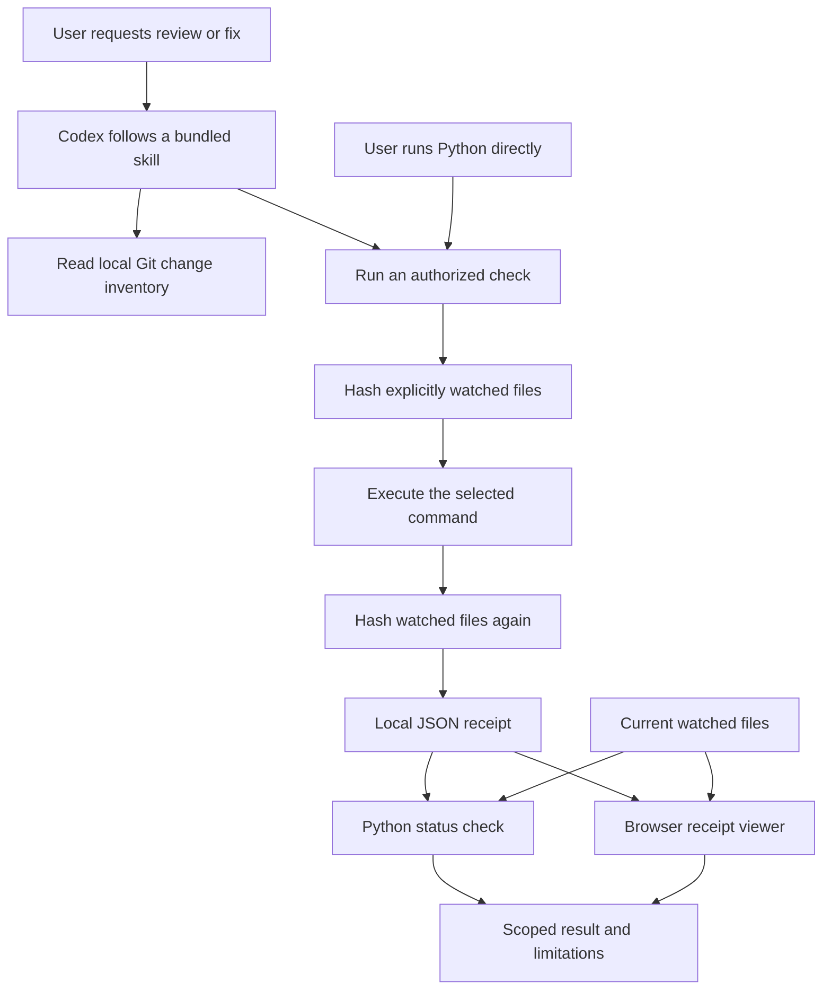

# Architecture

PatchProof separates agent guidance from deterministic local helpers. It has no background service, database, telemetry client, or custom model endpoint.

## Files and responsibilities

| Path | Responsibility |
|---|---|
| `skills/` | Instructions for review, focused repair, and factual handoff. |
| `scripts/snapshot.py` | Read-only Git inventory; never a correctness verdict. |
| `scripts/receipt.py` | Command execution, SHA-256 samples, JSON records, status, and saved HTML. |
| `scripts/demo.py` | Isolated calculator example with an actual failure, pass, and later edit. |
| `site/core.mjs` | Receipt validation, comparison rules, and Markdown summaries. |
| `site/app.mjs` | Browser file selection, local hashing, state display, and export. |
| `site/demo.json` | Synthetic calculator examples from the controlled integration test. |
| `scripts/build.py` | Manifest checks and an explicit allowlist for source packaging. |
| `tests/` | Python integration/unit checks and JavaScript core checks. |

`plugin.json` supplies the portable manifest. `.codex-plugin/plugin.json` is the Codex compatibility overlay. The local marketplace descriptor is `.agents/plugins/marketplace.json`. Identity and interface fields must agree; the package validator checks them.

## Trust and data boundaries

The host agent decides what to read and which permitted tools to use. Skill instructions guide it; they are not an enforcement layer. Codex's normal permissions, usage limits, and data policies apply.

The recorder runs a user-selected command with normal user permissions. It does not confine that process. It records arguments and metadata, not captured test output or source bodies. Those arguments and filenames still need review before sharing.

The browser treats imported JSON as data, validates its shape and paths, and renders text without treating it as markup. It hashes only selected watched files, within a total size limit. It has no upload endpoint or external scripts. Receipt/selection state stays in memory and clears on reload.

A matching pass requires a successful recorded command and matching watched bytes. Coverage remains explicit and incomplete: environments, remote services, unwatched files, and undetected between-snapshot changes can affect behavior. An unsigned receipt is a useful local record, not third-party proof.

See [command details](CLI.md), [privacy](../PRIVACY.md), and [security](../SECURITY.md).
